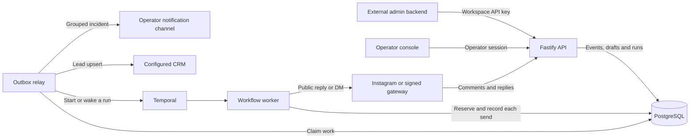

# Instagram comment automations

A person comments “pricing” on an Instagram post. The account replies publicly, sends a private question, waits for an email address and sends the requested link in Instagram. This repository implements the backend, an operator console, and a versioned HTTP API for embedding the workflow in another product.

**[Browse the public Swagger reference](https://psy-labs-admin.github.io/blotato-comment-automation/) · [Connect your backend](docs/integration.md) · [Open the handbook](docs/README.md)**

## Run it

Install Node.js 24+ and start Docker with Compose. On macOS or Linux:

```sh
git clone https://github.com/Psy-Labs-admin/blotato-comment-automation.git
cd blotato-comment-automation
npm run quickstart
```

Quickstart installs the locked dependencies, starts local PostgreSQL, runs migrations and opens the console using a single-use sign-in link. The workspace starts empty. Create a named draft in **Automations**, reload the page and reopen it. Drafts and API keys persist across restarts. On a headless machine use `npm run quickstart -- --no-open`. To reopen a running console use `node scripts/admin.cjs open`.

The usual origin is `http://127.0.0.1:3000`. If that port was occupied on first launch, use the port printed by quickstart. A dedicated existing PostgreSQL installation can be selected with a loopback `DATABASE_URL` on first launch. Local operator credentials live under `.local/operator/` with owner-only permissions.

## Connect an external admin

From a second terminal in the checkout, issue a named integration key and make the first request:

```sh
export BLOTATO_API_KEY="$(npm run --silent api:key -- create reviewer)"
export BLOTATO_API_URL=http://127.0.0.1:3000/api/v1
curl --fail-with-body -sS -H "Authorization: Bearer $BLOTATO_API_KEY" "$BLOTATO_API_URL/workspace"
node examples/external-admin.mjs
```

The first response contains the real workspace ID and name. The example reads connected accounts, recent runs and the first page of captured leads. Store the key in your **backend**. Your admin UI calls your backend using your existing user authentication. Every integration request is scoped to the workspace that issued its key.

For interactive requests, open [Swagger UI on your local API](http://127.0.0.1:3000/docs/), choose **Authorize** and enter an integration key. The [public Swagger reference](https://psy-labs-admin.github.io/blotato-comment-automation/) is browse-only. The same [OpenAPI 3.1 document](src/api/openapi.json) is served at `GET /openapi.json` for Postman, Insomnia and client generators.

| Your application needs to | API resources |
|---|---|
| Confirm identity and account readiness | `/api/v1/workspace`, `/api/v1/accounts` |
| Build and edit a rule | `/api/v1/drafts`, including revision-checked updates |
| Publish a rule or stop new runs | Draft publication, automation enable and disable |
| Show conversation progress | `/api/v1/runs` and each run’s timeline |
| Import captured leads | `/api/v1/leads` with cursor pagination and CRM status |

Read-only is the default key scope. A write key also permits draft changes, publication and activation. Each key can be revoked independently. The integration guide contains a complete draft-to-publish walkthrough, ID conventions, request examples, pagination and error handling. [Integration guide](docs/integration.md)

## How a comment becomes a conversation



1. **Accept and deduplicate.** The API verifies the webhook signature and stores the event with a provider ID and a per-conversation sequence. Duplicate deliveries reuse the existing event.
2. **Choose one rule.** The router locks the conversation, checks keyword, post scope, priority and suppression rules, then records the run and the command to start it in one transaction. Each run pins its published rule version.
3. **Send and wait.** The worker records each send attempt before calling Instagram. Temporal keeps the wait and deadline durable. PostgreSQL records which incoming reply was consumed. Restarting the worker resumes the same conversation.
4. **Capture the lead and finish.** A format-valid email creates a lead and a CRM delivery job. The workflow sends the link in an Instagram DM. CRM delivery retries independently.
5. **Recover with evidence.** A lost acknowledgement leaves the send outcome uncertain. The operator checks Instagram and records the outcome before another attempt. Operations shows stopped integration jobs, notifications and the health of the workers that can process them.

[Architecture and data model](docs/design.md) · [Send guarantees](docs/decisions/002-external-send-guarantees.md) · [Conversation ownership](docs/decisions/003-conversation-ownership.md)

## What you can run

| Environment | Available work |
|---|---|
| Fresh local installation | Console, persistent drafts, workspace keys, Swagger, reads and draft edits over the API. Accounts, runs and leads reflect actual stored data. |
| Connected installation | Publishing and real conversations require a verified account with the necessary permissions and a configured worker/relay pipeline backed by Temporal. An authenticated upstream gateway can supply the existing platform integration assumed by the interview brief. |
| Optional destinations | CRM lead delivery, Telegram or operational webhook notifications, Prometheus/Alertmanager and opt-in OpenTelemetry tracing. Each destination reports its own state. |
| Isolated acceptance suite | PostgreSQL, Temporal and Chromium exercise complete conversations, duplicate events, ambiguous sends, retries, tenant boundaries and API clients using controlled external provider responses. |

The native account integration implements Instagram Login. Meta’s newer **Unified Login** configuration still requires a separate account-connection implementation. A real Meta callback challenge was verified through a temporary HTTPS endpoint with comment and message subscriptions off. An end-to-end DM from a live account remains unverified. [Instagram setup and deployment](docs/instagram.md)

## Verify

```sh
npm run verify
```

The verifier provisions disposable infrastructure, checks types and the release build, exercises the API and browser flows, restarts a fresh workspace and processes duplicate traffic to completion. Run it from the repository root with Node.js 24+ and Docker. To use an existing local test administrator, set `DATABASE_ADMIN_URL` to a loopback PostgreSQL account that can create disposable databases.

Open `coverage/index.html` for coverage by source file, or `reports/acceptance/load.json` for event loss, send counts and completion latency. GitHub also tests the deployable container. [Scenario matrix](docs/testing.md) · [CI runs and reports](https://github.com/Psy-Labs-admin/blotato-comment-automation/actions/workflows/checks.yml)

## Project guide

- [Product capabilities and controls](docs/capabilities.md)
- [Operations and recovery](docs/operations.md) · [Monitoring and alert rules](docs/monitoring.md)
- [Telegram setup](docs/telegram.md) · [Tracing and load tests](docs/observability.md)
- [Worker upgrades and replay](docs/worker-upgrades.md) · [Human and AI contributions](AI_USAGE.md)
