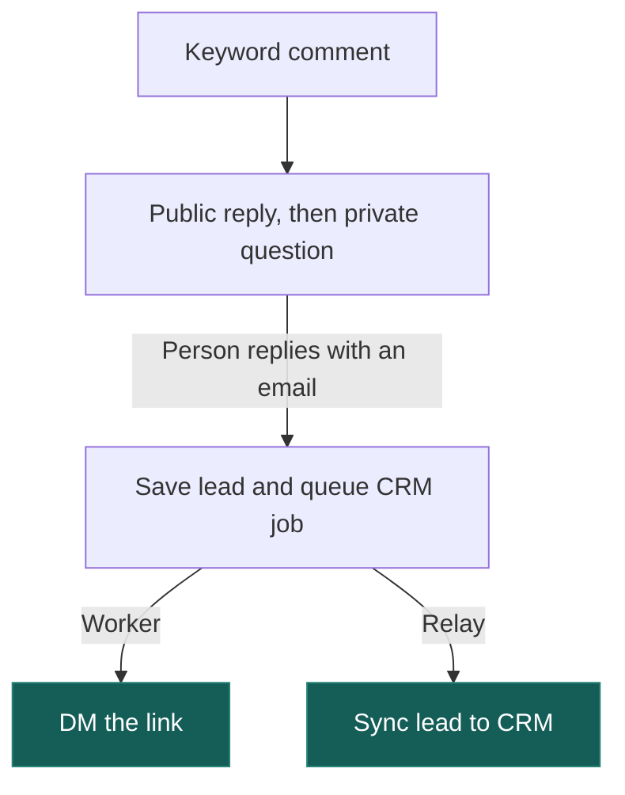

# Instagram comment automations

Someone comments “pricing” on an Instagram post. The account replies in public, asks for an email in private, then DMs the link. What if the person types faster than Instagram can confirm it sent the question? We have a test for that. [Fast-reply test](tests/failure-scenarios/races.test.ts) · [System diagram](docs/design.md#why-postgres-and-temporal)



## Run it

On macOS or Linux, start Docker with Compose and use Node.js 24 or later.

```sh
git clone https://github.com/Psy-Labs-admin/blotato-comment-automation.git
cd blotato-comment-automation
npm run quickstart
```

The console opens on an empty workspace. Go to **Automations**, name a draft, save it and refresh. The same draft comes back from Postgres. You can do it before connecting Instagram. On a headless machine, use `npm run quickstart -- --no-open`. To sign back in on your desktop, run `node scripts/admin.cjs open`.

## Connect your own admin

Give the sample client a read key in a second terminal, from the same checkout.

```sh
export BLOTATO_API_KEY="$(npm run --silent api:key -- create reviewer)"
node examples/external-admin.mjs
```

You’ll get the workspace identity, account count, recent runs and lead count. Zeroes are a perfectly good first result. The client assumes port 3000. If quickstart chose another, set `BLOTATO_API_URL` to the printed origin plus `/api/v1`. Keep the key on your backend. Open `/docs/` on the running workspace to try calls yourself. [Write a draft from your admin](docs/integration.md) · [Browse Swagger](https://psy-labs-admin.github.io/blotato-comment-automation/)

## Why Postgres and Temporal?

Change the pricing link while someone is typing their email. Which link should the worker send? Postgres keeps the version their conversation started with. Temporal keeps the wait alive through a deploy, right down to its original deadline.

Now suppose Instagram accepts the link DM and the worker dies before saving the receipt. A timeout is a lousy reason to DM someone twice. The operator gets the send history and can check what landed. [What the next worker sees](docs/design.md#the-send-that-might-have-happened)

## How far can you test it?

Run `npm run verify` for a full conversation, duplicate webhooks, a worker crash and recovery. The suite starts disposable Postgres and Temporal instances and controls Instagram’s responses so it can lose an acknowledgement on cue. The live Meta check covered the webhook handshake. To try the full flow in a real inbox, connect a professional account and start the worker and relay. [Test guide](docs/testing.md) · [Instagram setup](docs/instagram.md)

## Try a release

Pick a green push to `main` in GitHub Actions. In its staging job, two requests race to create the same draft. The API restarts, the client retries, and the test checks there’s still exactly one draft. That job ran the packaged image. Pick its run ID in **Deploy backend** to rehearse the deployment or promote those same bytes to a configured server. [Staging runs](https://github.com/Psy-Labs-admin/blotato-comment-automation/actions/workflows/checks.yml) · [Deployment guide](docs/releases.md)

[Handbook](docs/README.md) · [How we used AI](AI_USAGE.md)
