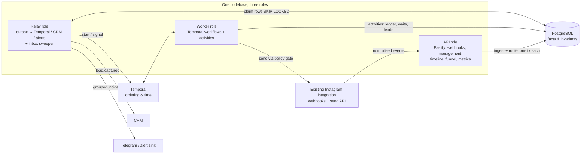
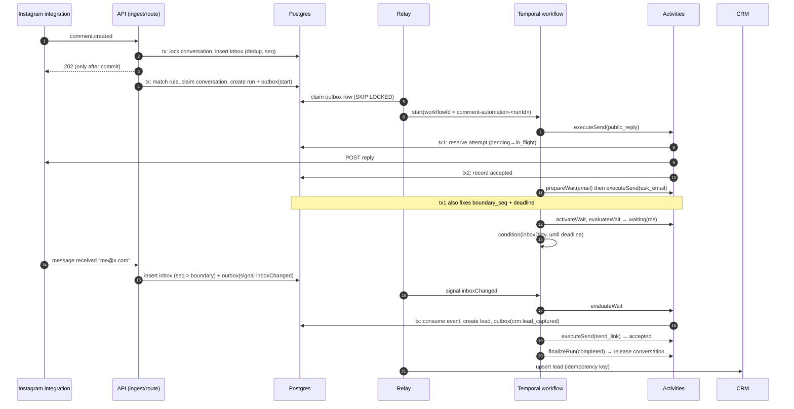

# Design: comment-triggered conversation automations

> When someone comments "pricing" on any Instagram post: reply "Sent you a DM!", DM them asking for
> their email, wait for the answer, then DM them a link.

This document describes the backend that runs that automation, and automations like it. Behaviour
described here is implemented in this repository unless [§15](#15-limitations-and-next-steps) lists
it as not implemented. Where a statement is backed by an automated test, the README's guarantee
table links to that test. The design went through an independent review; the findings and their
fixes are summarised in [AI_USAGE.md](../AI_USAGE.md).

---

## 1. The promise

What the system guarantees, in the order a customer would care:

1. **Every accepted comment has an explainable outcome.** A run started, or a recorded reason why not
   (no match, lower priority, conversation busy, cooldown, opted out, account inactive…).
2. **The person receives what was promised, once.** Duplicate webhooks, retries, worker crashes and
   restarts never produce a second public reply or DM.
3. **When we do not know whether a message was delivered, we say so.** The send becomes `unknown`.
   The conversation is held, nothing is resent blindly, an operator is alerted, and the timeline
   shows exactly where it stopped.
4. **A conversation survives restarts, and always ends visibly.** Waiting for the person's email can
   last days. That wait survives deploys, worker crashes and relay downtime, and its deadline never
   moves. Every run reaches a recorded end state: nothing stays "running" forever because its driver
   disappeared.
5. **Integrations are not on the critical path.** A CRM outage does not stop the person from getting
   the link. The lead syncs once the CRM is back, exactly once per idempotency key.

What it explicitly does **not** promise: exactly-once *delivery* to Instagram. No such contract
exists between our database and Meta's API (see [§7](#7-external-sends-the-ledger-protocol)).

## 2. Product contract

| Question | Rule (v1) |
|---|---|
| What triggers a run? | A new comment containing the keyword on a post of the connected account. Matching is whole-word and case-insensitive after NFKC normalisation (`#Pricing!` matches, `pricingplan` does not). Multi-word keywords match as a contiguous phrase. |
| "Any post"? | Any post of the connected account (`posts: "all_supported"`), or an explicit `mediaIds` list. |
| Edited comments | Not a trigger. Only `comment.created` is ingested. |
| Excluded | Comments/DMs authored by the connected account itself (our own reply could otherwise loop), echo events, opted-out participants, conversations in human takeover, inactive accounts. |
| Several automations match | One winner, chosen by `priority` desc then id. Losers are audited as `lower_priority`. |
| Same person comments on two posts | One active run per conversation (connected account × participant). The second trigger is recorded as `conversation_busy`. |
| Re-trigger after a run | Allowed after the run finishes **and** `cooldown_seconds` passes. An unresolved (`unknown`) send keeps the conversation held, so a finished run can still block re-triggers. |
| What counts as the email | The first message, after the question was reserved, that contains exactly one syntactically valid address. Format validity is not proof of ownership: leads are stored as `format_valid_unverified`. |
| No email / several emails in the reply | Never guess. Send at most `maxClarifications` (default 1, max 3) clarification DMs, then keep waiting until the deadline. |
| A second valid email | Ignored for this run (the wait is already consumed). Changing a captured contact is a separate action. |
| Where the link goes | Instagram DM, as the task specifies. The email is captured as a lead and synced to the CRM. Emailing the person is out of scope. |
| How long we wait | `timeout` per definition (e.g. `72h`). Measured from the reservation of the first question attempt. Never extended by retries, clarifications, restarts or recovery. This is a business setting, not a Meta limit. |
| After the deadline | `expired`. A late reply stays in the inbox/timeline and does not resume the run. |
| STOP / unsubscribe, human takeover, cancel | Stops future automated sends immediately (checked by every send). A send already in flight may still complete; the timeline shows it. |
| What "success" means | Instagram **accepted** the DM with the link. Delivered/read/clicked are different facts and appear only if a data source reports them. |

**Ordering risk, kept deliberately:** the task orders the public reply ("Sent you a DM!") *before*
the DM. If the DM is then blocked (privacy settings, window, account issue), the public reply has
made a false promise. The implementation keeps the specified order, because the definition is data
and the order is the customer's choice. For the real product I would recommend sending the private
reply first and posting the public reply only after it is accepted, or using softer copy
("Check your DMs 👋"). That is a one-line change to the definition, not to the engine.

## 3. How general is the engine, and why

**Decision: a small, typed, linear step language with engine-owned branches.** New definitions accept at most one email wait because each run captures one lead. It is not a graph
editor and it runs no user code.

```json
{
  "schemaVersion": 1,
  "trigger": { "type": "comment.created", "platform": "instagram", "keyword": "pricing",
               "match": "whole_word_case_insensitive", "posts": "all_supported" },
  "steps": [
    { "id": "public_reply", "type": "reply_comment",      "text": "Sent you a DM!" },
    { "id": "ask_email",    "type": "send_private_reply", "text": "What email should we send the pricing to?" },
    { "id": "email",        "type": "await_input", "validator": "email", "promptStep": "ask_email",
      "timeout": "72h", "maxClarifications": 1, "clarificationText": "That doesn't look like an email…" },
    { "id": "send_link",    "type": "send_message",       "text": "Here you go: https://…" }
  ]
}
```

Four step types: `reply_comment`, `send_private_reply`, `await_input`, `send_message`. Branches are
bounded and handled by the engine, not authored: *valid* continues, *invalid* triggers a bounded
clarification, *timeout* expires, *rejected/blocked* fails, *unknown* holds. Validation at publish
time (`src/domain/definition.ts`) enforces the platform rules structurally:

- `send_message` (a regular DM) is only allowed **after** an `await_input`. Meta's Send API requires
  the person to have messaged the account first; a comment alone is not that.
- At most one `send_private_reply` per definition. Instagram allows one private reply per comment.
- `await_input.promptStep` must be the send step right before it. The engine needs to know which
  send fixes the question boundary and deadline.
- Timeouts are 1s–30d. Clarifications are 0–3.

**Why not more general now?** Every extra degree of freedom (loops, arbitrary branches, user
code) makes "why did this stop?" harder to answer and "was this sent twice?" harder to guarantee.
Those two questions are the product. The engine is still built for extension:

| To add… | Change |
|---|---|
| A new step type (e.g. `tag_contact`, `wait`, `webhook`) | A zod schema entry + a case in the workflow + an activity. Sends reuse the ledger unchanged. |
| A new platform (Facebook, TikTok) | An adapter implementing `SocialPlatform` + a `Capabilities` contract. Ingest normalises into the same events. |
| New validators (phone, choice) | A function next to `extractEmail` + an enum value. |
| A visual builder | Emits the same JSON. The publish-time validator is the contract. |

**Versions:** publishing creates an immutable `automation_versions` row. A run pins its version and
receives the definition as workflow input, so editing text or links never changes a running
conversation. Business-definition version and worker-code version are different things
([§13](#13-change-management)).

## 4. Architecture



**The responsibility boundary is the core design decision:**

| Owner | Responsible for | Never responsible for |
|---|---|---|
| **PostgreSQL** | Durable inbox + dedup, per-conversation ordering, conversation ownership, which message answered which question, the send ledger (what was attempted / accepted / unknown), leads, outbox, audit log, run controls (cancel). | Deciding what step runs next. |
| **Temporal** | One workflow per run: step order, durable timers (deadline), bounded retries, waiting for wake-ups. | Facts. It never decides "was this sent?" or "is this the answer?"; it asks an idempotent activity. |
| **Adapters** | One HTTP call per attempt, classified into `accepted / rejected / not_sent / unknown`. No hidden retries. | Retrying or deduplicating. |
| **Status projection** (`automation_runs.status`) | Showing people where a run is. | Driving execution. The authoritative cancel lives in `run_controls`. |

There is deliberately **no second execution engine in Postgres** (no hand-rolled scheduler, no
`next_step_at` polling). Postgres stores facts; Temporal moves time forward. See
[ADR 001](decisions/001-durable-orchestration.md).

**Roles:** `ROLE=api|worker|relay|all` (`src/main.ts`). They are logical roles of one codebase. In
production they are separate deployments that scale independently. The relay runs two loops, one
for Temporal commands and one for integrations, so a slow CRM never delays workflow starts.

## 5. Data model

All tenant data carries `tenant_id`. **Composite foreign keys `(id, tenant_id)`** on every
tenant-scoped reference make it impossible for a row to reference another tenant's conversation,
connection, run, version, event or wait. A query bug fails loudly instead of mixing customers' data.
`run_controls`, `message_attempts` and `send_budget` have no tenant column of their own; they hang
off a tenant-scoped parent. External ids are always scoped by `connection_id`.
Usernames are never identifiers. Schema: [`migrations/001_init.sql`](../migrations/001_init.sql).

| Table | Purpose | Key constraints |
|---|---|---|
| `tenants`, `social_connections` | Customer and their already-connected account (token stays in the existing integration). `capabilities` is the versioned adapter contract (windows, budgets, reconciliation support). `sends_paused` is the account kill switch. | `unique(platform, external_account_id)` |
| `automations`, `automation_versions` | Trigger config, priority, cooldown; immutable published definitions. | `unique(automation_id, version)` |
| `conversations` | One row per (account, participant). **Its row lock serialises everything in a conversation.** `owner_run_id` = the single active run. `last_inbound_seq`, `last_inbound_dm_at`, `opted_out`, `human_takeover`. | `unique(connection_id, participant_id)` |
| `inbox_events` | Every accepted event: dedup key, per-conversation `seq`, our `received_at`, minimal payload, `routing_outcome`. | `unique(connection_id, event_type, provider_event_key)`, `unique(conversation_id, seq)` |
| `automation_runs` | Application run id, pinned version, trigger event, workflow id, status projection. | `unique(trigger_event_id)`: one run per trigger event |
| `run_controls` | Authoritative cancel request (checked by every send). | PK `run_id` |
| `input_waits` | The contract for matching input to a question: `boundary_seq`, `prompt_started_at`, `deadline`, clarifications used, consumed event, lead. Not a scheduler. | `unique(run_id, step_id)` |
| `input_consumptions` | Each inbound event evaluated at most once, by at most one wait, including invalid answers. | PK `inbox_event_id` |
| `message_intents` | **Send ledger:** one row per logical action (`run, step, action_no`), immutable fingerprint, status `pending → in_flight → accepted / rejected / unknown / blocked / cancelled`, provider message id, `resolved_by`. | `unique(run_id, step_id, action_no)` |
| `message_attempts` | Each attempt of an intent: timing, outcome, HTTP status, provider code, `recorded_late`. | `unique(intent_id, attempt_no)` |
| `send_budget` | Shared per-account send budget in fixed windows. | PK `(connection_id, window_start)` |
| `outbox` | Commands to Temporal and business events to CRM/alerts, written in the same tx as the change that needs them. | `unique(idempotency_key)` |
| `leads` | Captured email (`format_valid_unverified`), provenance, CRM status. | `unique(run_id)` |
| `incidents` | Grouped operational incidents (what goes to Telegram). | partial unique open `(tenant, connection, class)` |
| `run_audit_events` | Append-only decision log: the timeline. References and reason codes, never message bodies or emails. | — |

**Invariants and what enforces them:**

| # | Invariant | Mechanism |
|---|---|---|
| I1 | One logical inbound event, however often delivered | unique key on `inbox_events` |
| I2 | One run per trigger event | `unique(automation_runs.trigger_event_id)` |
| I3 | ≤ 1 active run per conversation, including runs with unresolved sends | `conversations.owner_run_id` set/cleared under the row lock; release requires no `in_flight`/`unknown` intents |
| I4 | An inbound event is consumed by ≤ 1 wait, once | PK on `input_consumptions` |
| I5 | One ledger row per logical send; retries are attempts of it | `unique(run_id, step_id, action_no)` |
| I6 | Only the attempt that owns an intent may record its outcome | fenced update on `current_attempt_id` |
| I7 | A wait's boundary and deadline are fixed once | `UPDATE … WHERE prompt_started_at IS NULL` in the reservation tx |
| I8 | Each business event is delivered under one idempotency key | `unique(outbox.idempotency_key)`, also sent to the CRM |
| I9 | No cross-tenant references | composite FKs `(id, tenant_id)` |

## 6. Execution model



**6.1 Ingest** (`src/ingest/ingest.ts`). One transaction: resolve the connection (404 if unknown),
upsert and lock the conversation row, insert the event (`ON CONFLICT DO NOTHING` → duplicate),
assign `seq = last_inbound_seq + 1` and `received_at = now`. Self-authored or echo events are stored
as `ignored_self`. A `STOP` DM sets `opted_out` and requests cancel of the active run **in the same
transaction**. That way no concurrent evaluation can treat "STOP" as an invalid email and send a
clarification. The webhook is acknowledged only after commit; if storage is down we do not ack.

**6.2 Route** (`src/ingest/router.ts`). Idempotent: the decision is taken under the conversation
lock and recorded on the inbox row. Comments: match active automations on the *current* published
version, pick the winner, check suppressions, then create the run + `run_controls` + set
`owner_run_id` + outbox `workflow.start`, all in one tx. DMs: if the owner run has a wait whose
boundary is set and `seq > boundary`, enqueue a `workflow.signal inboxChanged`. Otherwise record
`no_active_run` / `no_active_wait` / `before_prompt`. Routing runs inline after the ack for latency.
A sweeper (`routePending`, every 2s) routes anything a crash left behind.

**6.3 Outbox relay** (`src/relay/relay.ts`). Claims ready rows with `FOR UPDATE SKIP LOCKED` and a
lease in a short transaction, calls the handler **after commit** (no lock across the network), then
marks the row done or schedules a retry with jittered exponential backoff (dead-letter after
`maxAttempts`, surfaced as an incident). Delivery is at-least-once, so handlers are idempotent:

- `workflow.start` uses the fixed workflow id `comment-automation-<runId>` with
  `workflowIdConflictPolicy: USE_EXISTING`. "Already started" counts as done. Business dedup is in
  Postgres (I2), so it does not depend on Temporal's workflow-id retention.
- `workflow.signal` to a workflow that has not started yet is retried later, never dropped. A signal
  to a finished run is dropped (nothing left to wake).
- Temporal commands are **never dead-lettered**: a Temporal outage only delays them (visible as
  `outbox_oldest_pending_seconds`). CRM and alert rows dead-letter after their retry budget and raise
  an incident.

**6.4 The workflow** (`src/workflows/commentAutomation.ts`) walks the steps. Before a send that
prompts an `await_input`, it calls `prepareWait`. After the prompt is accepted, it calls
`activateWait`. The wait loop is:

```
loop:
  inboxDirty = false                       # cleared *before* evaluating
  r = evaluateWait(waitId)                 # under the conversation lock, reads the inbox itself
  valid    → next step
  clarify  → send clarification (ledger), loop
  waiting  → condition(inboxDirty || cancelled, timeout = min(r.msUntilDeadline, recheckMs))
  expired  → finish(expired)
  cancelled→ finish(cancelled)
```

Signals are **wake-ups, not data**. Lost, duplicated or reordered signals cannot change the outcome,
because the activity re-reads the inbox, and every wait also re-checks Postgres on its own every
`recheckMs` (10 min in production). A lost signal costs minutes, not a stuck run. The timer uses the
deadline stored in Postgres, the same value the activity checks. The workflow is deterministic: no
I/O, all facts come back from activities.

**Guaranteed end state.**
- DB and send activities retry with backoff: 40 attempts with a 30 s cap, about 15–20 minutes in total.
- If an activity still fails, the workflow catches the `ActivityFailure` and finalizes the run as
  `failed: activity_failed`. The finalizer retries until Postgres is reachable again.
- If the workflow itself disappears (terminated, history limit, a bug), the **orphan reconciler** in
  the relay role finalizes every unfinished run whose workflow is closed, as `failed: workflow_closed`.
- Either way, a send left `in_flight` becomes a visible `unknown` with an incident.

**6.5 Finalisation** (`finalizeRun`):
1. Any still-`in_flight` intent becomes `unknown`.
2. The outcome is recorded and open waits are closed.
3. The conversation is released **only if no intent of the run is unresolved**. Otherwise it stays
   held until the uncertainty is resolved.

Whoever settles an unknown send later (a late result, reconciliation, an operator) calls
`onIntentSettled`. It releases the conversation of a finished run, or wakes the active run. The
cooldown starts only if the run actually reached the person (at least one accepted send).

## 7. External sends: the ledger protocol

Between our commit and Instagram's acceptance there is no shared transaction. Temporal retries
activities but cannot close that gap. A naive "retry on timeout" sends the DM twice; a naive "mark
as sent before calling" loses DMs. The protocol (`src/activities/send.ts`,
[ADR 002](decisions/002-external-send-guarantees.md)):

```
Tx1  (conversation row lock)
  find-or-create intent (run, step, action_no) with immutable fingerprint
  status accepted          → return stored result        (re-entry after success)
  status unknown/terminal  → return it                   (never resend blindly)
  status in_flight         → previous attempt never recorded its outcome:
                             mark UNKNOWN (attempt_outcome_lost), open incident, return
  policy gate (cancel, opt-out, takeover, paused, window, recipient cap, budget)
  reserve: pending → in_flight, new attempt row, current_attempt_id
  if this is a question: fix boundary_seq / prompt_started_at / deadline (once)
COMMIT                                   ← before any network I/O
HTTP call (adapter: one attempt, timeout, no retries)
Tx2  (conversation lock, then intent) record the attempt outcome; update the intent only if this
     attempt still owns it (fencing); a late acceptance settles the intent and wakes / releases
```

Tx1 also refuses a question or a clarification whose wait deadline has passed (`deadline_passed`).

**Outcome classification** (`src/adapters/instagram.ts`):

| Response | Class | Ledger action |
|---|---|---|
| 2xx with message id | `accepted` | done, store provider id |
| 4xx with a message-level code (e.g. 10 "outside allowed window", 551 "person unavailable") | `rejected` | fail the step, no retry |
| 401 / Graph code 190 or 102 | `rejected` (`unauthorized`) | fail the step, **pause all sends of the account** (other runs wait), incident |
| 429, Graph throttling codes 4/17/32/613, 503 + `x-not-processed`, connection refused/DNS failure | `not_sent` (provably no effect) | intent back to `pending`, workflow sleeps `retry-after`, same intent retried (at most 24 h of deferral in total) |
| timeout, socket reset, other 5xx, 2xx without id | `unknown` | hold, incident, **no automatic resend** |

**Why the send activity may be retried by Temporal:** every entry goes through Tx1.
The crash cases that matter are covered by tests with real sockets:

- *Instagram accepted → worker died before Tx2 → Temporal retried*: Tx1 finds `in_flight` → `unknown`.
  No second send.
- *Worker died after Tx2, before Temporal got the result*: Tx1 finds `accepted` → returns it.
- *Slow attempt still running while a retry starts*: the retry marks `unknown`. When the slow
  attempt later gets Instagram's acceptance, that is authoritative evidence for **this attempt**, so
  the fenced Tx2 resolves the intent as `accepted` (`resolved_by = late_result`) and wakes the run,
  or releases the conversation of a finished one. This also covers "the operator said not sent,
  then the acceptance arrived before a retry was reserved": the intent becomes `accepted` and the retry is suppressed. An incorrectly authorized retry can still duplicate a DM once the second external call has started. Any other
  stale result is recorded on the attempt row only.

**Resolving `unknown`** accepts only authoritative evidence:

1. *Adapter lookup by client reference* (`reconciliation: lookup_by_client_ref`). The fake supports
   it. Real Instagram has no idempotency key or lookup, so the real contract is `none`. "Not found"
   never counts as proof of non-delivery.
2. *Operator decision* via `POST /intents/:id/resolve {accepted | not_sent, note}`, audited. `not_sent`
   authorises one deliberate new attempt of the same intent. There is no "retry everything" button.

Matching text and timestamps is not proof of identity, so the system never "guesses" a resolution.

## 8. Waiting for input: boundary, deadline and races

- **Boundary.** Right before the first question attempt leaves, under the conversation lock,
  `boundary_seq = last_inbound_seq`. Messages already in the inbox cannot answer a question that had
  not been asked. Messages that arrive while the question's HTTP call is still in flight have
  `seq > boundary`: they are kept and evaluated once the question is accepted.
- **Deadline.** `deadline = prompt_started_at + timeout`, fixed in the same transaction and never
  moved. Retries, clarifications, restarts and `unknown` recovery consume part of the window. That is
  a conservative product rule, and it is stated in the contract.
- **Admissibility.** A reply counts if *we durably received it* (`received_at`, assigned under the
  lock) by the deadline. Internal lag (a stuck signal, a slow relay) never turns an on-time answer
  into a late one: when the timer fires, `evaluateWait` first consumes admissible messages and only
  then expires the wait. Platform-side delivery delay is not compensated.
- **Skew safety.** Expiry requires `now ≥ deadline` inside the activity. If the timer fires a little
  early, the activity returns `waiting` with the remaining time and the workflow sleeps again.
- **Nothing is asked after the deadline.** A retry of the question (for example after an operator's
  "not sent") or a clarification is refused once the deadline has passed.
- **The backlog is read as a whole.** If a valid email is among the unconsumed replies, it is the
  answer. Earlier unusable messages are recorded as invalid without earning the person a "that
  doesn't look like an email" DM. Several invalid replies earn one clarification, not several.

| Race | Resolution |
|---|---|
| Email arrives before the question's ack | stored (`seq > boundary`), consumed once after activation |
| DM sent before the question was reserved | `before_prompt`, never consumed |
| Two emails at the same time | serialised by the conversation lock; lower `seq` wins; one lead, one link |
| Email + timer at the same moment | one transactional decision: consumed *or* expired, never both |
| Email in time, wake-up signal lost | timer path consumes it (test proves the lead is created after the deadline) |
| Same DM webhook twice | one inbox row (I1), one consumption (I4) |
| Retry of `evaluateWait` after commit | returns the stored decision (consumed / owed clarification) |
| STOP while evaluating | opt-out is set atomically with ingest; evaluation sees it under the lock |

**Known limitation:** without a reliable `reply_to` reference from the platform, we cannot *prove*
that a DM was meant as an answer to our question rather than an unrelated message. The one-active-run
rule prevents conflicts between automations. The boundary prevents old messages from counting. Intent
is still inferred, and the design says so.

## 9. Concurrency summary

- **One lock per conversation**, always taken first (`SELECT … FOR UPDATE` on `conversations`), by
  ingest, routing, send reservation, wait evaluation and finalisation. A consistent lock order
  (conversation → intent → incident) avoids deadlocks. Different conversations never contend.
- **No lock is held across the network**: send reservation and outbox claim commit before I/O.
- **Unique constraints back every "at most once"** (I1–I8), so even a logic bug produces a constraint
  violation instead of a duplicate.
- **READ COMMITTED + row locks** instead of SERIALIZABLE + retries: deterministic behaviour under
  load, no retry storms on hot conversations.
- **Workers, relays and API instances are stateless.** Any number can run. Shared limits (send
  budget) live in Postgres, not in process memory.

## 10. Instagram constraints and anti-spam

Every automated send passes one policy gate (`src/policy/gate.ts`) inside the reservation
transaction, re-evaluated right before the call. Conditions change while an action waits in a
queue. In order:

1. run cancel requested (`run_controls`), participant opted out, human takeover → `cancelled`
2. account sends paused → `deferred`: the conversation waits for resume or reconnect, up to 24 h.
   Connection not active → `blocked`. A capability the send needs is missing from the account's
   adapter contract → `blocked: capability_unknown`.
3. **window**: private reply only within `privateReplyWindowHours` of the comment. A regular DM only
   within `messagingWindowHours` of the participant's last DM → `blocked: window_closed`
4. **per-recipient cap** across all automations (`recipientHourlyLimit`) → `blocked`
5. **shared account budget** (`sendsPerWindow` per `budgetWindowSeconds`), reserved atomically in
   Postgres and never refunded for unknown outcomes → `deferred` until the next window

The first DM is a **private reply** to the comment (`recipient.comment_id`). Regular `send_message`
DMs are only possible after the person replied, which the definition validator enforces. A 401 /
expired token pauses the whole account and opens an incident ("reconnect the account"). New
triggers are suppressed (`connection_inactive`); conversations in progress wait instead of failing.

**Assumptions to verify before production** (Meta pages for private replies were not reachable
during research, so these are configuration in `capabilities`, not claims): exact private-reply
window (default 7 days), messaging window (24h), webhook fields per login route, rate limits per app
and per account, whether any idempotency/lookup exists. Capabilities are read strictly: a limit
the account's contract does not state blocks the sends that depend on it. Defaults are written once,
explicitly, when a connection is created. Rotating accounts, proxies or masking activity are
explicitly not part of the design.

## 11. Failure modes

| Failure | Automatic behaviour | Human needed when |
|---|---|---|
| Duplicate / reordered webhooks | dedup + per-conversation seq | never |
| API crash after ack, before routing | sweeper routes the stored event | never |
| Relay down | commands wait in the outbox; delivered on restart | backlog age alert |
| Temporal / worker down | ingest keeps working; Temporal commands wait in the outbox (never dead-lettered); runs resume; deadlines unchanged | prolonged outage |
| Postgres unavailable for minutes | activities retry with backoff; after ~15–20 min the run is finalized `failed: activity_failed` (the finalizer waits for the DB) | if it happens |
| Workflow lost (terminated, history limit) | orphan reconciler finalizes the run `failed: workflow_closed`; in-flight sends become `unknown` | if sends are unknown |
| Worker dies mid-send | ledger → `unknown` (or stored acceptance) | if unknown cannot be reconciled |
| Lost Instagram ack | `unknown`, conversation held, grouped incident | operator resolves via API |
| Instagram throttling (429, codes 4/17/32/613) | `deferred`, same intent retried after `retry-after`, up to 24 h in total | if queues stop draining |
| Token revoked | account sends paused (runs in progress wait), new triggers suppressed, incident | reconnect account |
| Account paused by an operator | sends wait at the gate; no new runs start; nothing fails within 24 h | resume |
| Window closed while queued | send blocked with reason, run fails visibly | usually never |
| CRM down | link still sent; lead `pending`; retried with backoff; incident after 3 failures; resolves itself | sustained backlog |
| Outbox row exhausted retries | dead-letter kept, incident | inspect + redeliver |
| No reply | `expired` (a product outcome, not an alert) | never |

## 12. Observability

- **Timeline** (`GET /runs/:id/timeline`, `src/timeline.ts`) answers "why did this run stop?" in
  plain language. Every line is a recorded fact. "Delivered" never appears, because Instagram only
  tells us it *accepted* a message. Example of a timeline for a completed run:
  ```
  Comment received on post post_spring_menu
  Rule "pricing" matched; published version 1 started
  Public comment reply (public_reply): accepted by Instagram
  Private reply (DM) (ask_email): accepted by Instagram
  Question accepted; waiting for an email until 2026-11-10T09:56:41Z
  Reply received; email passed the format check (not verified)
  DM (send_link): outcome UNKNOWN (provider_no_confirmation: connection_lost) — conversation held, no automatic resend
  Run paused until the uncertain send is resolved
  DM (send_link): outcome resolved as accepted (operator)
  Run finished: completed
  ```
  `GET /events/:id` answers "what happened to this webhook?". `GET /conversations/:id/timeline`
  shows every inbound event with its routing outcome.
- **Business funnel** (`GET /funnel`) computed from facts by run cohort: matched comments → runs
  started → questions accepted → emails captured → runs completed → CRM synced, plus suppression
  reasons and unknown sends. It counts unique runs, not raw webhook deliveries.
- **Metrics** (`GET /metrics`, Prometheus): DB-derived gauges, so they are true across processes:
  `outbox_oldest_pending_seconds{kind}` (start/signal/CRM/alert lag), `inbox_unrouted_oldest_seconds`,
  `intents_unknown` and its oldest age, `outbox_dead_rows`, `runs_by_status`, `incidents_open`, plus
  `webhooks_received_total{type,result}`. No run/user ids in labels; those live in the timeline and logs.
- **Alerts** (`src/alerts/*`): incidents grouped per (tenant, account, class), notified on open, at
  most every 15 minutes while open, and on resolve. Each one says what broke, how many conversations,
  since when, what was done automatically and what a person must do. It goes to Telegram when
  `TELEGRAM_BOT_TOKEN` is set, otherwise to a webhook sink. **No message bodies, emails or participant
  ids in alerts or logs.** Activities return ids, not lead emails, so captured addresses stay out of Temporal
  history except where a step needs it.

## 13. Change management

- **Disable an automation**: stops new runs; running runs continue unless cancelled.
- **Cancel a run** (`POST /runs/:id/cancel`): one transaction stores the authoritative cancel and the
  wake-up command. The response is `cancel_requested`, not "stopped": an in-flight send cannot be
  recalled, and a run with an unknown send keeps the conversation held.
- **Pause an account** (`POST /connections/:id/pause`): the gate holds all sends immediately and no
  new runs start. `resume` lets conversations in progress continue. A pause longer than 24 h fails
  the waiting sends visibly.
- **Edit a definition**: publishes a new version for new runs only. Migrating active runs would be a
  separate, explicit operation.
- **Deploy worker code**: workflow changes must be replay-safe (`patched()` or Temporal Worker
  Versioning with pinned deployments). Old workers stay until their runs finish. Replay tests against
  recorded histories belong in CI before production.

## 14. Scale

Illustrative profile (an assumption, not Blotato data): 100k inbound events/day, bursts of 100/s.

- Ingest is one short transaction per event, contending only per conversation. 100/s is far from
  Postgres limits. A viral post spreads across many conversations, not one row.
- Concurrent waits ≈ new conversations/day × average wait duration. Waiting workflows cost Temporal
  storage, not worker CPU.
- **History size.** At durable checkpoints the worker can continue with a fresh Temporal history. The continuation carries the current step, wait IDs, unresolved send and deferral budget. The same logical run, send ledger and absolute deadline stay in PostgreSQL. The replay and rollover suites exercise old histories, pending sends and email arriving during recovery.
- Hot paths are indexed: pending outbox by kind/time, pending inbox, unresolved intents, audit by run.
- Growth steps, in order of expected need: more relay/worker replicas; partition/archive
  `inbox_events` and `run_audit_events` by time with a retention policy; per-tenant fairness in the
  outbox claim (one popular account must not starve others); an external shared limiter only if
  measured budget contention appears. A broker (Kafka) would not remove any of the dedup or
  external-effect rules above.

## 15. Limitations and next steps

Implemented and tested here: everything in §§2–13 except as listed below.

- **Instagram**: the native adapter uses Instagram Login and the versioned Graph API. Webhooks are verified before normalization. An authenticated upstream integration remains an optional deployment mode. See [Instagram setup](instagram.md).
- **Operator authentication**: bearer tokens and browser sessions are bound to a tenant. The production identity provider and credential rotation belong to the host product.
- **Webhook authenticity**: the native endpoint verifies Meta’s signature over the raw body. The optional normalized endpoint accepts a separate timestamped HMAC from the trusted integration.
- **Retention and storage**: opt-in inbox redaction preserves active waits and unresolved sends. The operator must provision encrypted storage for application data and backups. Lead deletion and backup retention remain deployment policies.
- **Tracing**: opt-in OTLP traces cover HTTP, routing, activities and relay delivery. Audit identifiers provide the lookup path for an individual conversation. See [observability](observability.md).
- **Workflow upgrades**: a recorded pre-change Temporal history is replayed in the suite. Optional pinned Worker Deployment Versioning is exercised on a compatible Temporal dev server. See [worker upgrades](worker-upgrades.md).
- **Load testing**: the [local benchmark](observability.md) reports measured rates and latency for a short synthetic workload. The capacity estimates in §14 remain planning assumptions.
- **Edited comments, multiple platforms, visual builder, arbitrary graphs**: deliberately out of scope (§3).
