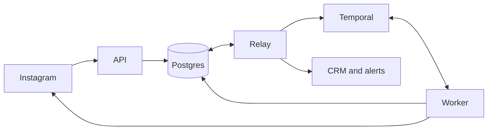

# How a comment becomes a conversation

Someone comments “pricing”, gets a DM asking for their email, and replies straight away. Meanwhile, our worker is still on `await send()`. The person is already a whole message ahead of us.

In the test, we hold the send acknowledgement for 1.5 seconds and slip the email into that gap. The API saves it as soon as it arrives. When the worker wakes up, the reply is there and the person gets their link. [The fast-reply test](../tests/failure-scenarios/races.test.ts)

## The flow we support

The brief puts the public reply first. “Sent you a DM!” is a bold thing to say one HTTP call before you actually send it. We’d go with “I’ll send the details privately.” Once the person replies with a usable email, the worker DMs the link. Success means Instagram accepted that last send.

`#Pricing!` matches. `pricingplan` doesn’t. We normalize Unicode and match whole words, ignoring case. A rule can cover all supported posts or just the media IDs you pick. Edits, our own comments and webhook echoes can't start a run.

What if the same person comments on two posts a second apart? One run gets the conversation. The other trigger gets `conversation_busy`. For two rules matching one comment, priority wins, then automation ID breaks ties. The run releases the conversation after it finishes and every send settles. An accepted send starts the cooldown at release. [Why one run gets the reply](decisions/003-conversation-ownership.md)

## A small engine on purpose

A rule has up to ten steps drawn from `reply_comment`, `send_private_reply`, `await_input` and `send_message`. It gets at most one private reply and one email wait. The question goes right before the wait. Regular DMs follow it. A wait can last one second to 30 days, with up to three clarifications.

When someone asks “Why did I get that DM?” we can point to the exact step and rule version. Arbitrary loops and user code would make that conversation longer. To add a step, define its inputs, teach the workflow when to run it and write the activity that does the work. [Definition and validation](../src/domain/definition.ts)

## Why Postgres and Temporal

Suppose we redeploy while someone is looking up their email. Postgres has their conversation, rule version and send history. Temporal has the current step and the timer. The replacement worker picks up the wait. We considered doing the scheduling in Postgres too. That would leave us writing our own timer and crash recovery code. [Why we chose Temporal](decisions/001-durable-orchestration.md)

## Getting work into the workflow

The API saves each incoming event with a sequence number before acknowledging it. Native callbacks verify Meta’s signature and leave routing to the relay. The signed gateway tries routing inline. A background sweep picks up anything still pending.

One Postgres transaction claims the conversation, creates the run and puts “start this run” in the `outbox`. If the process crashes on the next line, the relay still has the command. Retries use the same Temporal workflow ID. Relays share work with leases and `SKIP LOCKED`. Signals and periodic checks wake the workflow to read Postgres.

## Fast replies and other races

Back to that fast typist. When the worker reserves the question, it records the last inbound sequence number and fixes the deadline. Replies get saved even while the HTTP call is in flight. Once Instagram confirms the send, the worker checks replies within those bounds.

Say the person sends “yep” and then their email. By the time the worker wakes up, both messages are there. It reads the whole batch before deciding to ask again. The first reply with exactly one distinct valid address wins. That’s one lead even if two emails arrive. The timer checks the inbox before expiring the wait. An on-time reply still counts when the relay is late.

## The send that might have happened

Instagram accepts the DM. Our worker crashes before recording the response. An automatic retry would put a second, equally helpful copy of the pricing link in their inbox.

The worker reserves an attempt, commits, then calls Instagram once. It records the result against that attempt. On restart, an accepted send is done. An interrupted call becomes `unknown` and holds the conversation open. A late acknowledgement can settle it before the next attempt.

We retry automatically when we know the send failed before it took effect. For an `unknown` send, the native connector has no lookup. The operator checks Instagram, records acceptance or authorizes one retry. [Crash tests](../tests/failure-scenarios/crash-and-unknown.test.ts) · [Send ledger decisions](decisions/002-external-send-guarantees.md)

## The records that matter

| Question | Where to look |
|---|---|
| “Did we see this webhook twice?” | `inbox_events` deduplicates provider IDs per account. `conversations` keeps message order and the active owner. |
| “Which rule promised that link?” | `automation_runs` pins the published version. Editing the rule changes future runs. `run_controls` records cancellation. |
| “Which reply counted?” | `input_waits` stores the question boundary and deadline. `input_consumptions` records which event was used. `leads` links the captured address to its source reply. |
| “Did we send it?” | `message_intents` identifies one logical send. `message_attempts` records each attempt and what we heard back. |

## Controls and recovery

Before reserving a send, the worker checks cancellation, opt-out, takeover, account permissions, messaging windows and rate limits. A pause can defer a send for up to 24 hours. STOP records opt-out and cancellation together. A call already in flight may still land.

If the CRM is having a bad afternoon, the link DM can still go out. Saving the lead queues a separate CRM job. The relay retries it with the same idempotency key, which the receiver must honor. Exhausted retries show up in Operations. [Recovery playbooks](operations.md#incident-playbooks)

## What still needs care

A DM with an email could be answering a different question. A sequence number tells us which message came first. Only the person typing really knows what they meant.

Workflow changes have to replay old histories, including conversations still waiting for an answer. We use patches or pinned worker builds and test replay before rollout. Live Instagram delivery still needs an authorized account and public HTTPS. The [worker guide](worker-upgrades.md), [load check](observability.md#reproducible-load-check) and [Instagram setup](instagram.md) cover those details.
