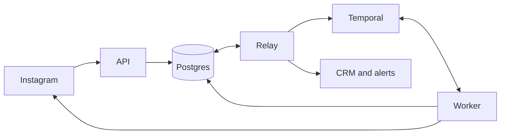

# How a comment becomes a conversation

## The flow we support

Someone comments “pricing”. They get a public reply, then a private question asking for their email. When they answer, we save the lead and DM the link. Success means Instagram accepted the link message. Delivery, reading and clicking need separate evidence.

Matching ignores case and uses whole words after Unicode normalization. `#Pricing!` matches. `pricingplan` does nothing. A rule covers all supported posts or selected media IDs. Edited comments, self-authored events and echoes cannot start this flow.

If several rules match, priority wins, then automation ID breaks ties. One connected account and participant form a conversation. It gets one active run. Another comment records `conversation_busy`. After release, cooldown applies when the run had an accepted send.

The requested public reply comes first. If the private reply fails, “Sent you a DM!” ages badly. “I’ll send the details privately” is safer copy for that first step.

## A small engine on purpose

Definitions contain up to ten ordered steps drawn from `reply_comment`, `send_private_reply`, `await_input` and `send_message`. A rule can have at most one email wait and one private reply. A regular DM must follow the wait. The prompt immediately precedes its wait. Publishing validates these rules, a timeout of 1 second–30 days and zero–three clarifications.

The engine knows what to do with a valid reply, a typo, a timeout or a failed send. Arbitrary loops and user code would make “why did this send?” much harder to answer. A new step needs schema validation, workflow handling and an activity. A platform needs an adapter and explicit capabilities. A builder can emit the same JSON.

Published versions are immutable. Each run keeps its original version, including text and links.

## Why Postgres and Temporal

Postgres lets us claim a conversation and queue its first step in one transaction. A row lock makes a second worker wait its turn. Temporal handles ordered steps, durable timers and retries across restarts. Building those timers and recovery rules around a polling table would leave us maintaining a workflow engine too. [ADR 001](decisions/001-durable-orchestration.md) records the tradeoff.

The API, relay and worker are roles in one codebase. Network calls happen after transactions commit. A slow Instagram call won't tie up the conversation lock.

## The records that matter

`conversations` holds ownership, inbound sequence numbers and participant controls. `inbox_events` deduplicates provider events within an account. `automation_runs` pins a version. The status you see in the console tells you how far the run got. Before sending, the worker checks `run_controls` for cancellation.

`input_waits` records the question boundary and deadline. `input_consumptions` gives each inbound event one evaluation. `message_intents` identifies a logical send by run, step and action number. `message_attempts` records its attempts. Unique constraints enforce those identities.

`leads` keeps one address per run, the reply it came from and the result of the format check. `outbox` stores commands and integration work alongside the transaction that created them. Tenant-scoped references use composite foreign keys. External identities are account-scoped, never usernames.

## Getting work into the workflow

When a webhook arrives, we lock the conversation, give the event a sequence number and save it before answering the request. Native callbacks verify Meta signatures and leave routing to the relay. The optional signed gateway attempts routing inline. A sweep recovers pending events from either path.

Once a rule wins, one transaction creates the run, gives it the conversation and queues the command to start it. The relay claims outbox rows with leases and `SKIP LOCKED`. Repeated starts use the same workflow ID. Signals wake workflows to reread stored facts. Periodic checks cover missed wake-ups.

## The send that might have happened

Instagram and Postgres share no transaction. A worker can lose the response after Instagram accepts a DM. Retrying that call could send it twice.

Every send, including the private question, uses the ledger in [ADR 002](decisions/002-external-send-guarantees.md). First reserve an attempt under the conversation lock and commit. Then make one adapter call without hidden retries. When the call returns, update that specific attempt so a late response can’t overwrite a newer one.

When the worker restarts, it reads the ledger first. If the send was accepted, it moves on. If the worker died mid-call, the attempt goes from `in_flight` to `unknown`. That holds the conversation and opens an incident. Automatic retries are safe when we know the send never happened. A late acceptance can settle uncertainty before another attempt starts. Other stale results stay on the attempt record.

Native Instagram has no configured reconciliation lookup. An operator checks Instagram, then records what they found. Marking the send accepted lets the run continue. Authorizing a new attempt can send a second DM if the first one actually landed.

## Fast replies and other races

Reserving the first question fixes `boundary_seq` and an absolute deadline. Older messages cannot answer it. A fast email arriving during the HTTP call stays eligible once the question is accepted. Retries and recovery never extend the deadline.

Say the person replies “sure” and follows up with an email before the worker wakes up. We check both replies before asking them to clarify. The first message with exactly one distinct valid address wins. Even two valid replies produce just one lead. Duplicate webhooks produce one event and one consumption.

When the timer fires, we check what had already arrived by the deadline. An on-time reply still counts if the relay was running late. Conversation locks serialize email versus expiry, concurrent sends and competing triggers. STOP ingestion stores opt-out and cancellation atomically. A send already reserved may still complete.

Without a reliable reply reference, an unrelated DM can look like an answer. Ownership and boundaries reduce ambiguity. They cannot establish intent.

## Controls and recovery

Each send reservation checks cancellation, opt-out, human takeover, account state, configured windows, recipient limits and a shared account budget. Missing capabilities block dependent sends. Pauses and throttling defer work within a 24-hour deferral budget. Unknown sends keep their reserved budget.

CRM work runs independently with an idempotency key the receiver must honor. An outage leaves the lead queued while the link flow continues. Exhausted delivery needs operator recovery.

Operators can pause accounts, cancel runs and resolve uncertain sends. Timelines explain decisions, metrics expose backlogs and incidents group failures. The run gives up the conversation once it has finished and every send is settled. A background check catches workflows that closed before they could do that.

## What still needs care

Workflow code must replay deterministically. Changes use patches or pinned worker deployments and replay tests. History rollover preserves the logical run and database deadlines.

Live Instagram approval needs an authorized account and public HTTPS deployment. Capabilities must match that account’s approved contract. Production identity, encrypted storage, backups and deletion policies belong to deployment. Run the [load check](observability.md#reproducible-load-check) to see how long the slower conversations took and whether any events went missing. [Operations](operations.md) covers what to do when the queue keeps growing.
