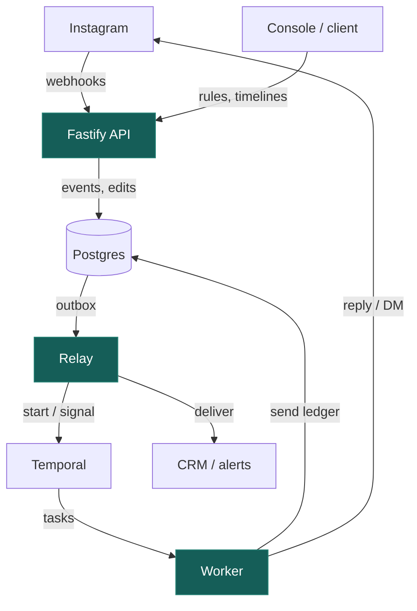
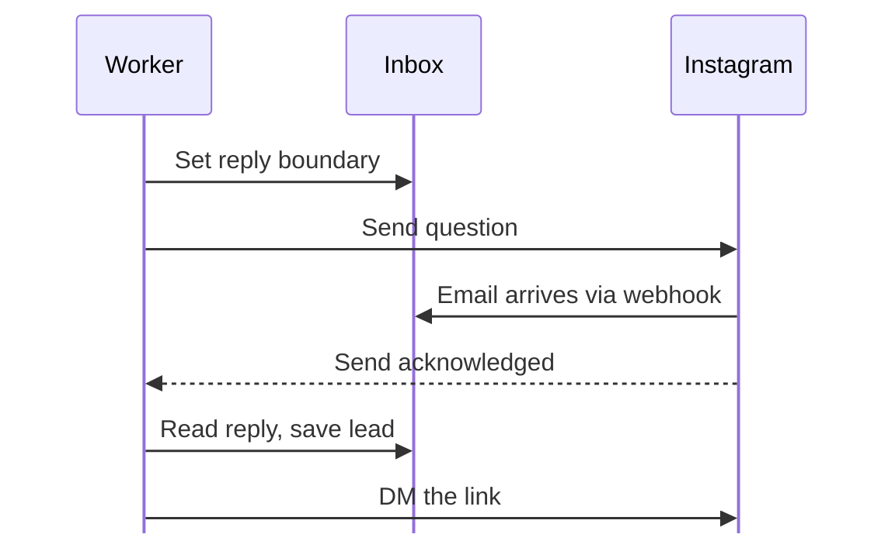
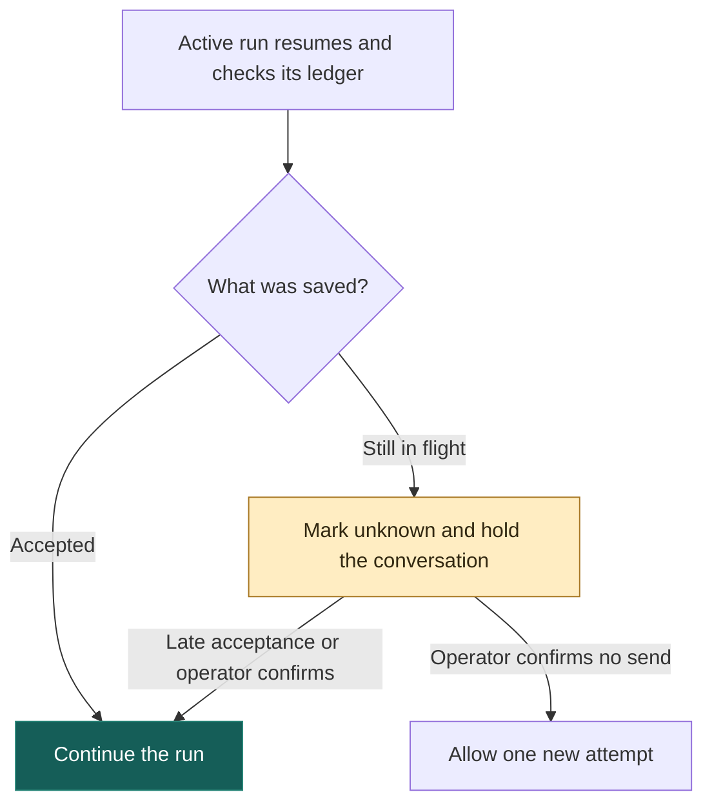
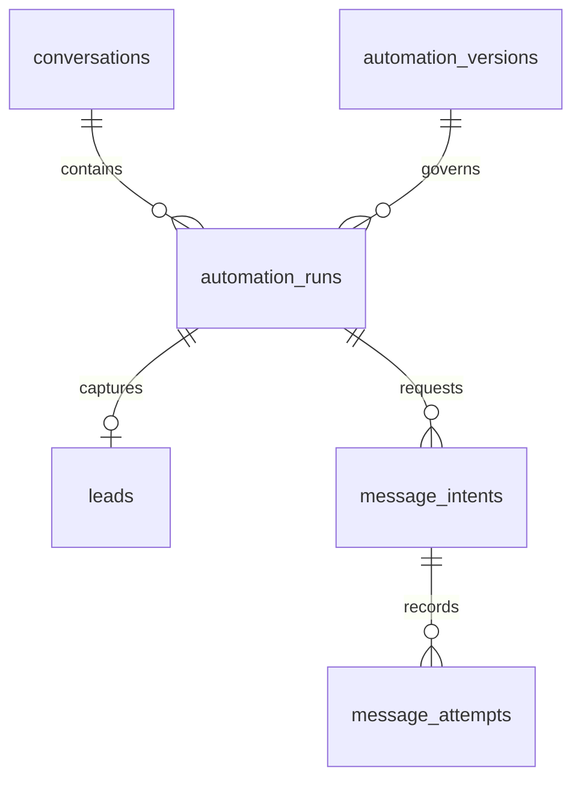

# How a comment becomes a conversation

Someone comments “pricing”, gets a DM asking for their email, and replies straight away. Meanwhile, our worker is still on `await send()`. The person is already a whole message ahead of us.

In the test, we hold the acknowledgement for 1.5 seconds and slip the email into that gap. The worker still sends exactly one link. Here’s what has to agree for that to work. [Fast-reply test](../tests/failure-scenarios/races.test.ts)

## The flow we support

“Sent you a DM!” is a bold thing to say one HTTP call before you actually send it. The brief asks for the public reply first, so the rule keeps that order. “I’ll send the details privately” gives the private call some room to fail.

A rule can watch all supported posts or a list of media IDs. We normalize Unicode and match whole words, ignoring case. `#Pricing!` triggers the rule. `pricingplan` doesn’t. Edits, our own comments and webhook echoes can’t start a conversation.

Two matching rules on one post? Priority wins, then automation ID breaks the tie. Two comments from the same person on the same account? While one run owns the conversation, a competing trigger gets `conversation_busy`. Ownership ends once the run finishes and its sends settle. An accepted send starts the cooldown at release. [Conversation ownership](decisions/003-conversation-ownership.md)

## A small engine on purpose

A rule has up to ten steps. The pricing rule starts with `reply_comment`, asks through `send_private_reply`, pauses at `await_input` and finishes with `send_message`. The private question sits right before the wait. A regular DM needs a preceding wait. Each rule gets at most one private reply and one email wait, with a timeout from one second to 30 days and up to three clarifications.

When someone asks “Why did I get that link?”, we can pull up the step and the published version that supplied it. That gets harder once rules can loop or execute arbitrary code. Adding a step here means defining its inputs, teaching the workflow when to call it and writing the activity that does the work. [Definition and validation](../src/domain/definition.ts)

## Why Postgres and Temporal

Suppose we deploy while someone is typing their email. Postgres remembers the conversation, the original rule version and which sends we attempted. Temporal remembers where the run paused and when its timer expires. The replacement worker picks up the same wait. Doing the scheduling in Postgres too would give us a timer service of our own to debug. [Why we chose Temporal](decisions/001-durable-orchestration.md)

## Getting work into the workflow

The API saves an incoming event and assigns its sequence number before acknowledging it. Native callbacks verify Meta’s signature and leave routing to the relay. The signed gateway tries routing inline. A background sweep picks up anything still pending.

When a rule wins, one transaction claims the conversation, creates the run and queues its start command in the `outbox`. If the process dies just after commit, the relay still has the command. Relays lease jobs using `SKIP LOCKED`. On retry they use the same Temporal workflow ID. Signals wake the workflow to check Postgres. A timer covers a missed signal.

## Fast replies and other races

Before the private question leaves, the worker records the current inbox sequence number and fixes the deadline. That gives us a slice of inbox history to check once Instagram confirms the send.

Say the person sends “yep” and follows up with their email. If both are waiting when the worker wakes, it reads the whole batch before asking for clarification. The first message with exactly one distinct valid address wins. Even two valid replies produce one lead. When the timer fires, it checks what arrived by the original deadline. A slow relay can’t make an on-time reply late.

## The send that might have happened

Instagram accepts the DM. Our worker dies before recording the response. Sending it again feels reasonable right up until you look at the recipient’s inbox.

Every attempt gets its own record. The worker commits the reservation, calls Instagram once with the lock released, then records the result against that attempt. Proven transient non-sends can retry automatically. For an interrupted call, the native connector has no lookup that can tell us whether that particular DM landed. The operator checks Instagram and records the evidence. If the run has already ended, confirming a non-send cancels the intent. A finished run stays finished. [Crash tests](../tests/failure-scenarios/crash-and-unknown.test.ts) · [Send ledger decision](decisions/002-external-send-guarantees.md)

## The records that matter

Start at `automation_runs` when a reviewer asks where a link came from. Each run points to its conversation and the exact version it used. Follow the other direction to see what the run tried to send.

For a reply, follow the lead’s `source_event_id` back to `inbox_events`. Provider IDs deduplicate within an account. `input_waits` keeps the question boundary and deadline, and `input_consumptions` records which reply counted. [Database schema](../migrations/001_init.sql)

## Controls and recovery

A lot can change while a message is queued. Each send reservation checks cancellation, opt-out, takeover, account permissions, messaging windows and rate limits. A pause can defer a send for up to 24 hours. A participant’s STOP records opt-out and cancellation together. A call already in flight may still land.

If the CRM is having a bad afternoon, the link DM can still go out. Saving a lead queues a separate CRM job. The relay retries with the same idempotency key, which the receiver must honor. An exhausted job shows up in Operations with its history. [Recovery playbooks](operations.md#incident-playbooks)

## What still needs care

A sequence number tells us which message came first. It can’t tell us whether an email was the answer to some *other* question in the same inbox. A format check can’t tell us who owns the address either.

A worker upgrade has to replay conversations that are still open. For a change in step order, we use patches or pinned builds and test old histories before rollout. For an actual comment-to-DM check, we need public HTTPS and an authorized professional Instagram account. [Worker upgrades](worker-upgrades.md) · [Load check](observability.md#reproducible-load-check) · [Instagram setup](instagram.md)
