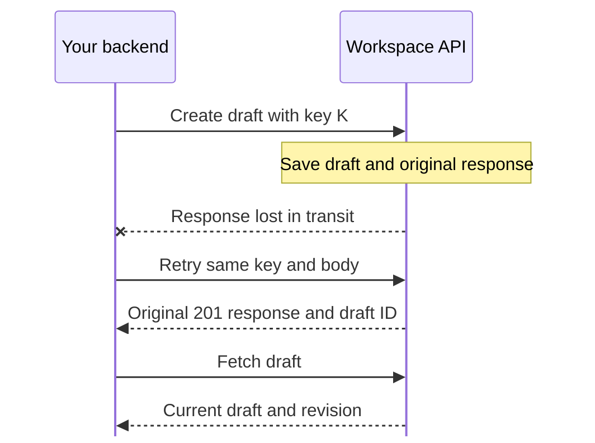

# Connect your application

Use a backend integration key to read runs and leads. Add write access to manage rules. The account owner connects Instagram in the console.

[Swagger reference](https://psy-labs-admin.github.io/blotato-comment-automation/) · [OpenAPI 3.1](../src/api/openapi.json) · [Node client](../examples/external-admin.mjs)

## First request

Run `npm run quickstart`, then open another terminal in the checkout with Node 24+.

```sh
export BLOTATO_API_KEY="$(npm run --silent api:key -- create reporting)"
export BLOTATO_API_URL=http://127.0.0.1:3000/api/v1
node examples/external-admin.mjs
```

Use quickstart's port if different. The client prints workspace identity, account-record count, recent run IDs/statuses, first-page lead count and whether more leads exist. A fresh workspace has zero counts and no runs.

Check which workspace you opened, then read back the draft you saved in the console.

```sh
curl --fail-with-body -sS -H "Authorization: Bearer $BLOTATO_API_KEY" "$BLOTATO_API_URL/workspace"
curl --fail-with-body -sS -H "Authorization: Bearer $BLOTATO_API_KEY" "$BLOTATO_API_URL/drafts"
```

For interactive requests, open local `/docs/`, choose **Authorize**, paste the key and execute `GET /workspace`. Authorization lasts until reload. Browse the public reference or import your installation's `/openapi.json` into Postman, Insomnia or a client generator.

## Credentials and deployment

Keys default to `read`, including captured emails. `--write` adds draft creation, editing, publication and rule enable/disable. Keep keys in backend secret storage and enforce user permissions yourself.

```sh
npm run --silent api:key -- list
# To revoke a key, paste its management ID and press Enter.
read -r KEY_ID
npm run --silent api:key -- revoke "$KEY_ID"
```

Creation prints the token once to stdout and its management ID to stderr. Rotate by issuing a replacement, checking `GET /workspace`, then revoking the old ID. Revocation affects subsequent requests across replicas.

Quickstart resolves its private database/workspace settings. On managed hosts, apply migrations and set `DATABASE_URL` and `BLOTATO_TENANT_ID` for the administrator CLI. Containers can use `node scripts/api-key.cjs`. Use the deployed HTTPS origin plus `/api/v1` as your client base URL.

## Build and publish a rule

Create a draft with a write key.

```sh
export BLOTATO_API_KEY="$(npm run --silent api:key -- create 'Rule editor' --write)"
node examples/external-admin.mjs --create-draft "Pricing replies"
```

Keep `draftId` and `revision`. Authorize local Swagger and edit through `PATCH /drafts/{id}`. Its example body is editable. Sending `content` replaces the whole object. A name-only edit to a fresh draft takes `{"expectedRevision":1,"name":"Pricing replies v2"}`. Use each save's returned revision for the next edit or publish.

To match `prcing` as well as `pricing`, include `allowKeywordTypos: true` inside the draft’s `content` and publish that revision. Omitted or false keeps exact matching. A matching timeline entry tells you when the typo setting made the difference. [Examples and tie handling](design.md#when-someone-types-prcing)

API-only installations can save drafts. Publication needs configured dispatch and a verified, publishable [Instagram connection](instagram.md). From `GET /accounts`, use internal `id` as `connectionId`. The separate `accountId` identifies Instagram's account.

Call `POST /drafts/{id}/publish` with the current revision. Keep the draft ID for edits and `automationId` for enable/disable. Publication returns immutable `versionId` and numeric `version`. Disabling stops future matches. Active conversations retain their starting version.

## Read conversations and leads

Use `GET /runs?limit=25`, optionally with `status=waiting_input` or `needsReview=true`. Inspect `/runs/{id}` and `/runs/{id}/timeline` for decisions and provider acknowledgements. Acceptance cannot establish that someone read a message.

`GET /leads` returns emails, run/conversation IDs and CRM status. Use lead IDs for downstream upserts. Collection checks email format.

Drafts, rules, runs and leads page newest first. Pass `nextCursor` as `cursor` with unchanged filters until null. Limits default to 25, maximum 100. Cursors are workspace-scoped item IDs. Reads show current state without a change stream.

## Conflicts and retries

For `409 revision_conflict`, fetch, merge and retry with the current revision. Other publication conflicts can indicate account/dispatch readiness. Read the error body and account `issue`.

Retry reads with bounded backoff. For draft creation, retain one optional `Idempotency-Key` and request body per intended draft. Every attempt needs valid write access.

```sh
export DRAFT_CREATE_KEY="$(node -e 'console.log(crypto.randomUUID())')"
curl --fail-with-body -sS -X POST "$BLOTATO_API_URL/drafts" \
  -H "Authorization: Bearer $BLOTATO_API_KEY" \
  -H "Content-Type: application/json" \
  -H "Idempotency-Key: $DRAFT_CREATE_KEY" \
  --data '{"name":"Pricing replies"}'
```



Run the curl twice. Both return the original `201` response, even after edits or credential rotation. Fetch for current state. Workspaces remember successful keys indefinitely.

Keys are case-sensitive, 1–128 ASCII letters, digits or `._:-`. Changed input returns `409 idempotency_conflict`. Object field order is ignored. Names/post IDs are trimmed, connection UUIDs lowercased and missing content becomes `{}`. Array order matters. Invalid headers/bodies return `400`. Failed creates leave keys reusable.

Without the header, each successful create makes another draft. This contract covers only `POST /drafts`. Repeating successful publication at the same revision returns the existing version. Check other writes' effects before retrying.

Draft text must be valid Unicode. A pasted NUL or a broken surrogate returns `400 invalid_request`. An unsuccessful edit leaves the draft at its previous revision.

## Verify the client

[Verification](testing.md) covers schemas, credential isolation, revisions, pagination and the runnable client.
