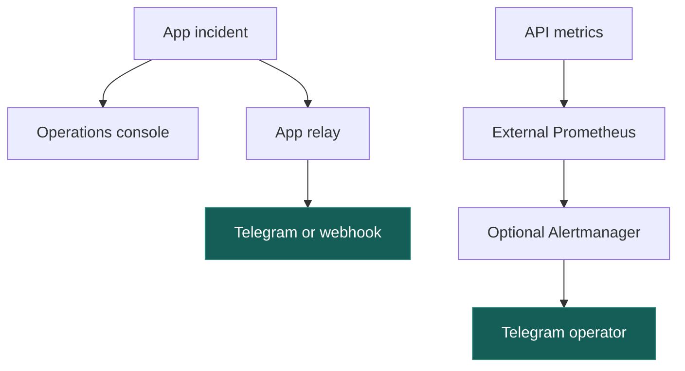

# Monitoring and recovery

When conversations stall, check `/ready` and queue age. `/live` checks process, `/health` database, `/ready` pipeline. API-only dispatch shows `disabled`.

Workers check in with Temporal. Relays also report whether they can drain each delivery queue. Replicas report every 10 seconds, going stale after 45 seconds. One healthy replacement keeps the role available.

**Operations** shows workspace queues, incidents and delivery receipts. Unconfigured destinations keep jobs queued. Telegram silence tells you little.



Run Prometheus on another host, with independent paging for monitor failure.

### Delivery expectations without API secrets

When credentials live only on relays, set API `EXPECTED_DELIVERIES=crm,alerts,metadata` to require those consumers. Pick the ones you need. Empty means none. Unknown names, duplicates and empty list items stop startup. API credentials also imply expectations.

Relays advertise started services. Missing expected consumers fail readiness, block retry and keep queue alerts active even with another healthy relay.

## Recovery

Fix the destination, then retry stopped CRM or metadata jobs in **Operations** with their current generation and a reason. [The retry request](operations.md#crm_delivery_failing) locks the job, advances its generation and writes an audit event in one transaction. Stale requests get 409. Reload first.

Retry needs a healthy matching consumer and valid target. Synced or missing leads cannot retry. The CRM must honor the original idempotency key, since a timed-out delivery may have succeeded. Metadata refresh keeps its cache lease.

Check Instagram before [resolving uncertain sends](operations.md#incident-playbooks). Notifications retry up to their limit. When they stop, inspect receipts and repair the channel.

## Prometheus

Scrape `/metrics` with the bearer token matching `METRICS_TOKEN_HASH`. Database gauges cover the installation. Sum native Instagram counter rates across API replicas.

Load [alerts.yml](../deploy/monitoring/alerts.yml) and check the [thresholds](operations.md#signals-to-watch). Optional unconfigured destinations are excluded. API alerts catch failed scrapes and an empty target list. Notifications include recoveries.

## Run the external monitor

Provision a quickstart workspace’s metrics credential without displaying it.

```sh
npm run monitoring:init
```

For a custom deployment, use your secret manager to put the token on one line in `.local/monitoring/metrics.token`.

```sh
mkdir -p .local/monitoring
chmod 700 .local/monitoring
# Provision metrics.token before continuing.
chmod 644 .local/monitoring/metrics.token
docker compose -f compose.monitoring.yaml up -d prometheus
```

The private parent protects the token. The container’s `nobody` user needs file read access. Compose mounts it read-only at `/run/secrets/metrics_token`.

Prometheus scrapes `host.docker.internal:3000` by default. For another port, create `.local/monitoring/targets.yml`.

```yaml
- targets: ['host.docker.internal:3100']
```

Export `MONITORING_TARGETS_FILE=./.local/monitoring/targets.yml` before starting Compose. Set API `HOST` to a container-reachable interface. For remote APIs, use their host/port and add `labels: {__scheme__: https}` to the entry. TLS verification stays enabled.

At `http://127.0.0.1:9090/targets`, confirm `UP`, then check `/alerts`. Initially there is no recipient. The loopback UI keeps 15 days of metrics in a named volume. For host storage, set and reuse `MONITORING_DATA_VOLUME` with a dedicated writable directory inside a private parent.

### Enable Telegram for one selected operator

Alertmanager sends service alerts separately from [application incidents](telegram.md). Start the bot or add it to your group. Use a numeric chat ID. A dedicated bot separates rate limits.

Provision a private token file, then enable delivery.

```sh
./deploy/monitoring/enable-telegram.sh "$TELEGRAM_BOT_TOKEN_FILE" "$TELEGRAM_CHAT_ID"
docker compose --env-file .local/monitoring/telegram.env -f compose.monitoring.yaml --profile telegram up -d
```

Alertmanager groups failures, sends recoveries and repeats active alerts every four hours. Messages carry alert names and fixed summaries. Configuration checks send no test messages.

Stop outbound alerts and restore standalone Prometheus with both commands.

```sh
docker compose --env-file .local/monitoring/telegram.env -f compose.monitoring.yaml --profile telegram stop alertmanager
docker compose -f compose.monitoring.yaml up -d --force-recreate prometheus
```

Stop the stack while keeping volumes below. Omit the env file and profile if Telegram was never configured.

```sh
docker compose --env-file .local/monitoring/telegram.env -f compose.monitoring.yaml --profile telegram down
```

## CI configuration validation

Run from the repository root with Docker. Offline runners need pinned images pulled first.

```sh
./deploy/monitoring/check.sh
docker compose -f compose.monitoring.yaml config --quiet
docker compose -f compose.monitoring.yaml --profile telegram config --quiet
```

The script checks configuration and rules in containers with networking disabled and temporary credentials. With local Prometheus tools, use `promtool check rules deploy/monitoring/alerts.yml` and `promtool test rules deploy/monitoring/alerts.test.yml`.

For recovery fencing, tenant boundaries and role observations, point `DATABASE_ADMIN_URL` at an administrative database and run `npx vitest run tests/integration/operations.test.ts`. It creates a throwaway database. After deployment, confirm the live target is `UP` too.
