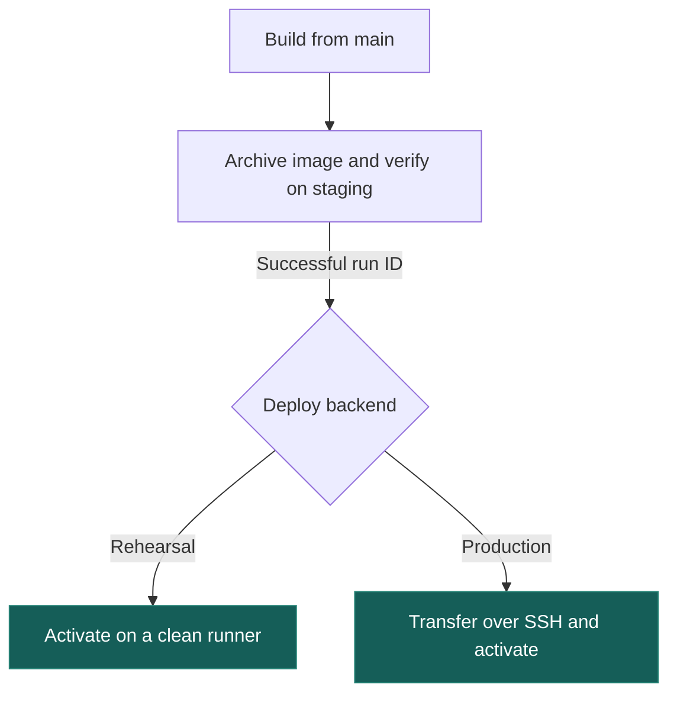

# Deploy a backend build

Pick a green `main` push in [Verify and stage backend](https://github.com/Psy-Labs-admin/blotato-comment-automation/actions/workflows/checks.yml). Open the staging job to watch two requests race to save a draft. It restarts the packaged API with the same Postgres database, then exercises the production activation script on a disposable Linux host. The summary records the commit, image ID and results. These installations disappear afterward.



## Try a deployment from GitHub

1. Copy the successful run ID after `/actions/runs/` in its URL.
2. Open [Deploy backend](https://github.com/Psy-Labs-admin/blotato-comment-automation/actions/workflows/deploy.yml), click **Run workflow** and select **main**.
3. Choose **rehearsal** and enter the ID. GitHub verifies the saved image and activates it on a clean runner. Forks need Actions enabled and a successful `main` push.

The `backend-<commit>` artifact retains `image.tar.gz`, `image.id` and `SHA256SUMS` for 14 days. Both targets accept only completed, successful `main` push runs from this repository's `checks.yml`. Anyone can read the public run summary. Starting workflows requires write access.

## Connect a production host once

Production updates the API on Linux/amd64. Supply DNS, HTTPS, PostgreSQL and any workers, relays and Temporal service your installation uses. The API applies migrations at startup.

Plan worker and relay upgrades separately. Candidate releases never replace operator-installed host scripts or service credentials. The activation command updates only the API container and leaves its dependencies running.

- Install Docker Engine, Compose 2.24.4+, Bash, Python 3, `flock` and `sha256sum`. Give a dedicated nonroot `blotato-deploy` SSH account Docker access.
- Under `/srv/blotato`, install [compose.deploy.yaml](../compose.deploy.yaml), [Caddyfile](../deploy/Caddyfile), [image override](../deploy/release/compose.image.yaml) and [executable release script](../deploy/release/production.sh) at their repository paths. Keep them operator-owned. Provide a private, deploy-account-writable `releases/` directory.
- Put credentials and `ROLE=api` in `service.env`, and `PUBLIC_HOST` in `.env.deploy`. Restrict both files. Keep credentials and rendered Compose configuration out of logs. Start PostgreSQL and required background services first. [Service settings](operations.md#deploying)
- Use Compose project `blotato`. On a fresh host, start the proxy separately.

```sh
cd /srv/blotato
BLOTATO_ENV_FILE=/srv/blotato/service.env docker compose --env-file .env.deploy -f compose.deploy.yaml up -d --no-deps https
```

- In **Settings → Environments**, restrict **production** to `main`. Add secrets `PRODUCTION_HOST`, `PRODUCTION_SSH_KEY` and `PRODUCTION_KNOWN_HOSTS`. SSH uses port 22. Verify the host key fingerprint through the server console. Set environment variable `PRODUCTION_PUBLIC_HOST` to the public API DNS name.
- Docker access grants host-level privileges. Prefix the dedicated key in `blotato-deploy`'s `authorized_keys` with `restrict,command="/srv/blotato/deploy/release/production.sh"` and a space. This accepts only `activate <commit> <image-id> <archive-sha256>` with validated identifiers. Add a reviewer if required.

## Promote or roll back

Choose **production** and the verified run ID. GitHub checks checksums, image identity and platform, then streams the archive over SSH. The host serializes deploys, verifies the transfer before loading, activates without rebuilding or pulling, and checks the running image, Docker health and local `/ready`. GitHub checks public HTTPS `/ready`. The summary identifies the actual candidate and source run, including older builds.

Failed transfers leave the old API serving. After activation failure, inspect the container and `/srv/blotato/releases/history.log`. The candidate may already be running. Rollback is manual. Promote a compatible older run while its artifact remains available. Check schema compatibility and backups first. Rollback preserves migrations and messages already accepted.
